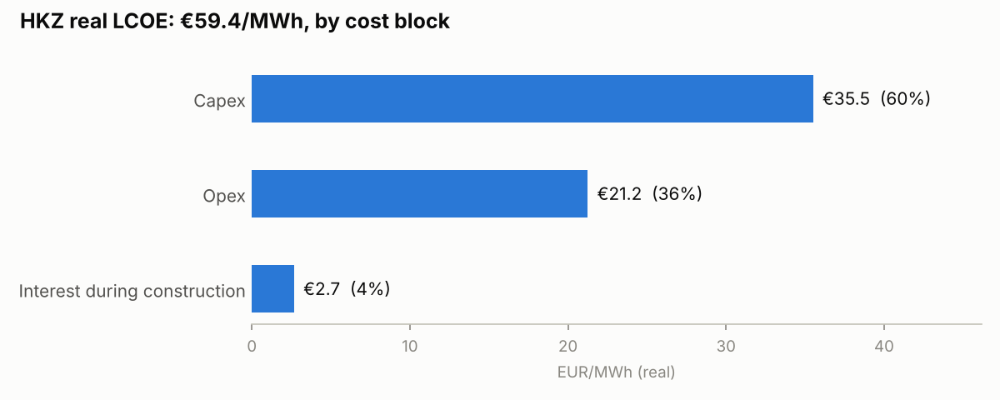

# 1 — What does a MWh from Hollandse Kust Zuid cost?

> **Question:** What does a MWh from Hollandse Kust Zuid (HKZ) cost over its life, and which cost blocks dominate?

## Why it matters

HKZ is a 1.5 GW offshore wind farm in the Dutch North Sea, built without subsidy and fully operational in 2023. Before you can reduce LCOE you need to know where it comes from. Splitting it into capex, financing during construction and opex shows where cost-reduction effort pays off most.

## Method

A discounted cash-flow model in Excel:

```
LCOE = Σ (costs_t / (1 + r)^t)  /  Σ (energy_t / (1 + r)^t)
```

- Capex plus interest during construction counted at the commercial operation date (year 0)
- 30 operating years, end-of-year cash flows
- Net output = gross capacity factor × (1 − each loss), degrading 0.5% per year
- **Real LCOE** uses flat real opex and the real WACC (4.41%). **Nominal LCOE** inflates opex at 2% and uses the nominal WACC (6.5%).
- Pre-tax: corporate tax is not included (see Limitations)

## Inputs & sources

Each input is labelled **Actual** (public fact), **Sourced** (public estimate or benchmark) or **Assumption**.

| Input | Value | Type | Source / note |
|-------|-------|------|---------------|
| Capacity | 1,500 MW | Actual | Vattenfall/BASF press release: 139 turbines, 1.5 GW |
| Turbines | 139 × Siemens Gamesa SG 11.0-200 DD | Actual | power-technology.com project page |
| Operating life | 30 years | Assumption | Typical offshore design life (25–30 years) |
| Gross capacity factor | 55% | Assumption | Calibrated so P50 output is about 6 TWh/yr |
| Losses: wake / availability / electrical / other | 8% / 5% / 2.5% / 3% | Assumption | Typical offshore ranges |
| **Net capacity factor** | **45.5%** (5,974 GWh in year 1) | Result | |
| Degradation | 0.5% per year | Assumption | Offshore range 0.3–0.5% per year |
| Capex | €2,200/kW | Sourced | ≈ €3.3 bn total (Windpower Monthly, Aug 2020) ÷ 1.5 GW. Excludes grid connection, which TenneT builds. |
| Opex | €80/kW/yr | Assumption | Offshore benchmark €60–90/kW/yr |
| Nominal WACC | 6.5% | Assumption | Offshore benchmark ~5–7% |
| Inflation | 2% | Assumption | ECB target |
| Construction period / interest rate | 3 years / 5% | Sourced / Assumption | FID June 2020, full operation 2023 |

## Result

| | Real | Nominal |
|---|---|---|
| **LCOE** | **€59.4/MWh** | **€73.9/MWh** |
| Capex | €35.5 (60%) | €44.5 (60%) |
| Opex | €21.2 (36%) | €26.1 (35%) |
| Interest during construction | €2.7 (4%) | €3.3 (5%) |



## So what

- **Capex dominates (64% including construction interest).** Each 1% saved on capex lowers the real LCOE by about **€0.38/MWh**. Foundations, installation and procurement are the first place to look.
- **Opex is large for offshore (36%).** Each 1% saved on O&M is worth about **€0.21/MWh**, more than half the value of a 1% capex saving. It also continues over 30 years, so savings can still be made after the farm is built.
- **Energy yield matters most per percent.** Each 1% more net output lowers LCOE by about **€0.59/MWh**, more than a 1% cut in any single cost block. Availability and wake losses (13% combined here) are therefore direct LCOE levers.
- **Construction time has a price.** Construction interest adds €2.7/MWh. A shorter build or cheaper construction finance reduces it.

## Limitations & next steps

- **Pre-tax.** Corporate tax (25.8% in NL) is left out, as in simple LCOE comparisons such as IRENA's. Judging whether the project earns its cost of capital needs an after-tax view, which write-up 2 covers.
- **Capex is an estimate** from press reports, and it excludes the grid connection. That matters when comparing with countries where the developer pays for transmission.
- **Single deterministic case.** There's no uncertainty or sensitivity analysis yet.
- **Interest during construction is simplified** to simple interest on half the capex over the build period.
