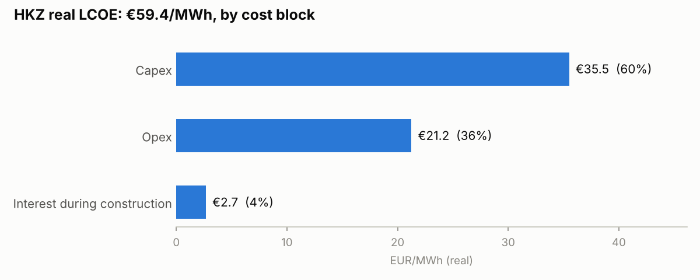

# LCOE of Hollandse Kust Zuid

A cost study of **Hollandse Kust Zuid (HKZ)**: a 1.5 GW offshore wind farm in the Dutch North Sea with 139 × 11 MW turbines, built without subsidy and fully operational since 2023.

It looks at what a MWh from HKZ costs, what drives that cost, and which levers bring it down. The model is built in Excel from public data.

## Headline

Real LCOE ≈ **€59/MWh**. Capex (including construction interest) makes up 64% of it, and opex 36%.



## Contents

| | Question | Status |
|---|---|---|
| [Write-up 1](01-hkz-lcoe.md) | What does a MWh from HKZ cost, and what drives it? | Done |
| Write-up 2 | Does HKZ earn its cost of capital after tax, and which levers close the gap? | Coming soon |
| Excel model | Inputs, year-by-year model, financing and cost levers | Coming soon |

## What is LCOE?

LCOE is the constant price per MWh a project would need over its life to cover all its costs, including a return on capital:

```
LCOE = present value of lifetime costs / present value of lifetime energy
```

## Data

All inputs come from public sources. Each one is labelled as an actual figure, a sourced estimate or an assumption, and they are listed in [write-up 1](01-hkz-lcoe.md#inputs--sources). No confidential or employer data is used.

## About

A self-directed study of offshore wind LCOE. Feedback and questions are welcome via Issues.
